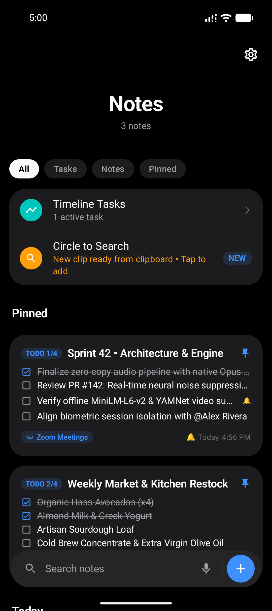
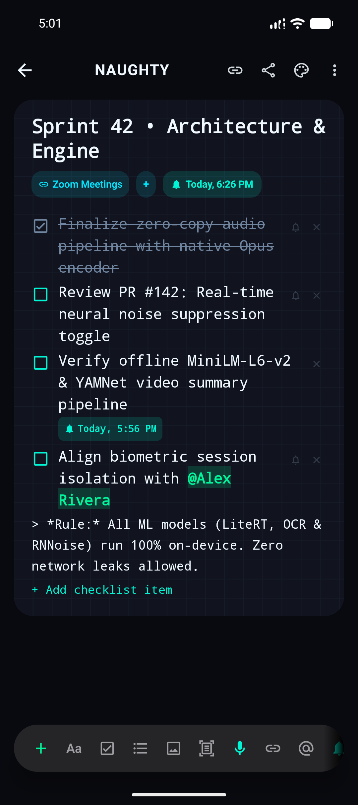
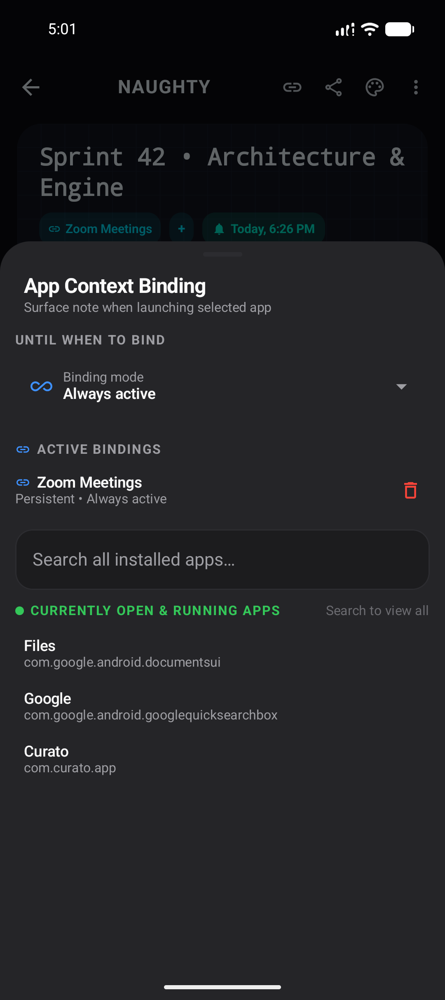
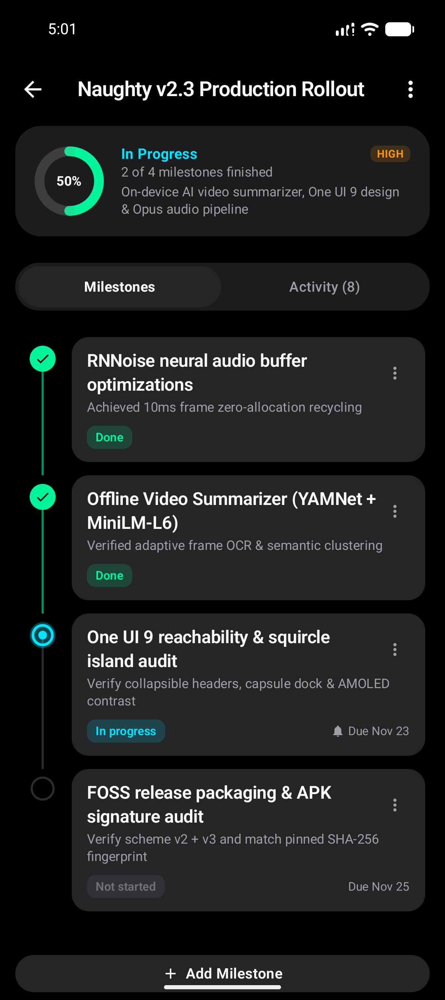
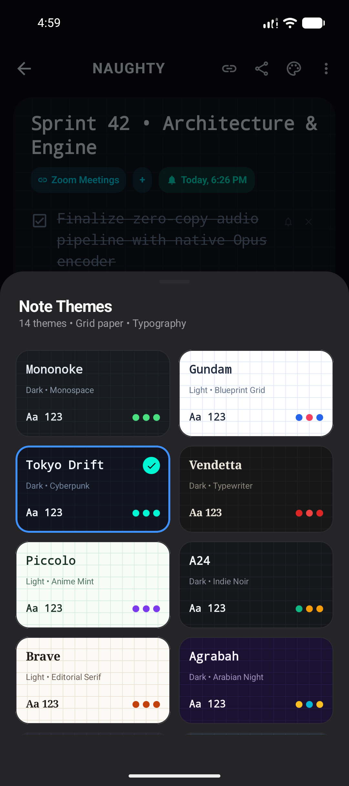

<div align="center">

# 📓 NAUGHTY

### *The Context-Aware, Offline-First Markdown Workspace & Timeline Engine for Android.*

[](https://github.com/pritesh-ranjan/Naughty/actions)
[](https://github.com/pritesh-ranjan/Naughty/releases/latest)
[](https://github.com/pritesh-ranjan/Naughty/releases)
[-34D399?style=flat-square&logo=android&logoColor=white)](app/build.gradle.kts)
[-059669?style=flat-square)](PRIVACY.md)
[](SECURITY.md)
[](LICENSE)

<br/>

> **Naughty connects your notes to your actions.**  
> Built strictly offline-first with a handcrafted **Samsung One UI 9** interface, Naughty surfaces relevant notes, checklists, and references the moment you open designated applications—eliminating app-switching and search friction. Powered by on-device AI for video summarization, neural voice denoising, speech transcription, and OCR, every note is saved as a physical Markdown (`.md`) file on device storage for absolute privacy and complete data ownership.

<br/>

<p align="center">
  
  
  
  
  
</p>

<br/>

[Core Capabilities](#-core-capabilities) •
[Design System](#-one-ui-9-design--handcrafted-themes) •
[Technology Stack](#-technology-stack) •
[Privacy & Security](#-privacy--security) •
[Download & Build](#-download--build) •
[License](#-license)

---

</div>

<br/>

## ⚡ Core Capabilities

### 🧠 Context-Aware App Binding & Circle to Search Capture
* **Autonomous App Surfacing**: Link any note or checklist to specific third-party applications (e.g., view shopping lists inside delivery apps, or meeting agendas inside Zoom).
* **Flexible Trigger Rules**: Configure bindings to surface **every time**, **once** (auto-deactivating after trigger), or until a **custom expiry date/time**.
* **Circle to Search & Lens Capture**: Automatically detects when you finish looking something up in Circle to Search or Google Lens and offers a one-tap prompt to save your findings linked to the source app.
* **Zero Disruption**: Displays as a lightweight heads-up alert that automatically recedes when switching away from the bound application.

### 🎬 100% Offline Video Summarizer
* **Share-to-Summarize Pipeline**: Share any video up to 3 minutes from your gallery or third-party apps to turn spoken audio and on-screen text into crisp, structured bullet-point notes.
* **Adaptive Frame Sampling & Geometry OCR**: Dynamically scales frame sampling (`1.0` to `8.0 FPS`) based on visual scene changes and tracks persistent on-screen text overlays using ML Kit bounding-box geometry.
* **On-Device Acoustic & Semantic AI**: Uses **YAMNet** (via Google AI Edge LiteRT) to classify speech vs. music tracks and **MiniLM-L6-v2** sentence embeddings to semantically fuse and deduplicate spoken transcripts with visual OCR text.
* **Background Execution**: Processes asynchronously in the background with live progress indicators, a home screen status banner, and completion alerts.

### 📝 Hybrid Markdown Editor, @ Mentions & Todo System
* **Dual Editing Surface**: Fluidly switch between tactile block editing (interactive checkboxes, text blocks, media chips) and raw full-text Markdown.
* **Drag-and-Drop Checklist Reordering**: Long-press and drag checklist items to reorder tasks with smooth auto-scrolling and tactile haptic feedback.
* **@ Mentions & Smart Deep Links**: Type `@` while writing to search and tag **Contacts**, **Installed Apps**, or **Calendar Events** as interactive color-coded pills with one-tap navigation.
* **Dedicated Todo List & Miniature Floating Popup**: Manage tasks in a pinned `"Todo"` note with live completion counters (`2/5`), or launch the floating **Quick Note Popup** directly over any app via launcher shortcuts without leaving your current screen.
* **Visual Attachments & On-Device OCR**: Attach up to 10 optimized images per note with a fullscreen zoom/pan viewer and extract printed or handwritten text offline via Google ML Kit.
* **Inline Reminders & Snapshot Undo/Redo**: Embed native timestamps (`[🔔 Label](reminder:<timestamp>)`) inside Markdown text with 30-step in-memory undo/redo history.
* **Publication-Grade PDF & Markdown Export**: Export notes as raw `.md` files or multi-page A4 **PDF documents** that preserve paper textures, typography, checklists, and images (with automatic print-friendly contrast adaptation for dark themes).

### 🎙️ Neural Voice Notes & Direct Opus Streaming
* **Real-Time Neural Denoising**: On-device AI noise suppression (**Audx RNNoise**) eliminates background noise, wind, and hum at 48 kHz during capture.
* **Mid-Recording Denoise Toggle**: Switch between neural noise suppression and raw microphone audio on the fly without interrupting the recording stream.
* **Zero WAV Overhead**: Decoupled audio capture and encoding threads stream 48 kHz PCM frames directly into native `MediaCodec` Opus/Ogg (`.opus`) files without intermediate WAV files.
* **Interactive Waveform Player**: WhatsApp-style 40-bar soundwave scrubber with tap-and-drag seeking, duration badges, external sharing, and `1x` / `1.5x` / `2x` playback speed control.
* **Live & File Speech Transcription**: Dictate live during recording or transcribe existing audio files into text 100% offline.

### 🗺️ Multi-Step Timeline Engine
* **High-Stakes Workflow Tracking**: Manage complex multi-stage efforts (visa applications, home purchases, product launches) with customizable stages and ordered milestones.
* **Deterministic Progress**: Computes completion accurately (`done / (total - cancelled)`), automatically excluding cancelled milestones and safely handling custom stage changes.
* **Audit Trail & Milestone Alarms**: Immutable-style activity log records every status transition and timestamped update alongside exact deadline reminders.

### 📥 Universal Share Ingestion & OS Integration
* **Interactive Multi-Modal Share Sheets**:
  * **Videos**: Inspect FPS, resolution, and audio tracks before summarizing speech and frame OCR into bullet points.
  * **Images (Single & Batch)**: Choose to **Attach Image**, **Extract Text (OCR)**, or **Both (Image & OCR Text)**.
  * **Audio & Voice Memos**: Choose to **Attach Voice Note**, **Transcribe Audio**, or **Both (Audio & Transcript)**.
  * **Text & Web Links**: Automatically cleans Markdown headers and formats raw URLs into clean domain slugs.
* **System Text Selection Menu**: Highlight text in any application and tap **"Add to Naughty"** to capture snippets immediately.
* **Launcher Quick Shortcuts**: Long-press the app icon for instant access to **New Note** (floating popup), **Todo List**, or **Timeline Tasks**.
* **Reboot-Resilient Exact Alarms**: Scheduled note and milestone reminders persist across device reboots with optional one-tap Google Calendar export.

### 🔒 Hardware-Backed Biometric Security
* **Biometric Authentication**: Lock confidential notes behind fingerprint, facial recognition, or device credential fallback via `BiometricPrompt`.
* **Zero Preview Leakage**: Locked notes mask body text, media, and subtitles across home cards, universal search, and context notifications until authenticated.
* **In-Memory Session Isolation**: Unlocked state is retained strictly in memory during the active session and resets automatically when leaving the app.

---

## 🎨 One UI 9 Design & Handcrafted Themes

### Samsung One UI 9 Interface
Naughty's surrounding application chrome is engineered around **Samsung One UI 9** design principles for effortless one-handed ergonomics and OLED clarity:
* **Reachability Architecture**: Collapsible large-title headers transition smoothly into compact navigation bars on scroll, paired with a floating bottom capsule dock (`[ 🔍 Search notes │ ＋ ]`).
* **AMOLED Pitch-Black & Squircle Islands**: Pure `#000000` dark surfaces with 24dp squircle card groups, inset hairline dividers, chronological date sections (`Pinned`, `Today`, `Yesterday`, `This week`), and fluid bottom sheets.

### 14 Handcrafted Note Canvas Themes
Inside the editor, customize individual notes with 14 curated typographic palettes paired with procedural paper textures (**Blueprint Grid**, **Dot Grid**, **Ruled Lines**, and **Clean Canvas**) rendered directly on Compose Canvas:

| Theme | Tone | Palette Vibe |
| :--- | :--- | :--- |
| **Mononoke** | Dark | Emerald Monospace & Deep Charcoal |
| **Gundam** | Light | Technical Blueprint Grid & Royal Cobalt |
| **Tokyo Drift** | Dark | Cyberpunk Neon Cyan & Electric Magenta |
| **Vendetta** | Dark | Typewriter Noir & Crimson Accent |
| **Piccolo** | Light | Anime Mint Paper & Royal Violet |
| **A24** | Dark | Indie Cinema Slate & Warm Amber |
| **Brave** | Light | Editorial Serif & Burnt Terracotta |
| **Agrabah** | Dark | Arabian Night Violet & Desert Gold |
| **Dracula** | Dark | Classic Dracula Slate, Pink & Mint |
| **Nord** | Dark | Arctic Frost Steel & Glacier Cyan |
| **Gruvbox** | Dark | Retro Warm Groove & Ochre Earth |
| **Solarized** | Light | Terminal Parchment & Solar Cyan |
| **Dot Matrix** | Dark | 80s CRT Phosphor Green Glow |
| **Flexoki** | Light | Inky Warm Paper & Forest Pine |

---

## 🛠️ Technology Stack

Naughty is engineered with modern Android architecture guidelines, leveraging an offline-first dual-storage pattern, on-device neural models, and Baseline Profile optimizations:

| Layer | Architecture & Libraries | Description |
| :--- | :--- | :--- |
| **Language & Toolchain** | Kotlin 2.3.20 • JVM Target 17 • AGP 9.0.1 • KSP 2.3.12 | 100% Kotlin codebase built with modern Gradle toolchains |
| **UI & Design System** | Jetpack Compose • One UI 9 Suite • Navigation 3 • Coil 3 | Declarative UI, custom One UI 9 components, and async media loading |
| **Architecture** | Unidirectional Data Flow (UDF) • Coroutines • StateFlow | Reactive state management with fast manual dependency injection |
| **Storage Engine** | Hybrid Dual-Storage: Room 2.8.4 (SQLite) + Markdown & DataStore | Room indexes metadata, bindings, and timelines; note bodies live as `.md` files |
| **On-Device AI & ML** | Google AI Edge LiteRT (YAMNet & MiniLM-L6-v2) • ML Kit • Audx RNNoise | 100% local video summarization, semantic embeddings, OCR, speech-to-text, and neural denoising |
| **Audio & Media Engine** | AudioRecord (48 kHz PCM) • MediaCodec Opus • MediaExtractor • PdfDocument | Real-time Opus/Ogg streaming, adaptive video frame extraction, and A4 PDF rendering |
| **Security & Performance** | AndroidX Biometric • Hardware Keystore / TEE • Baseline Profiles | Hardware-backed biometric locks and AOT Baseline Profiles for instant startup |
| **Platform Target** | Android 7.0 (API 24) to Android 16 (API 36) | Target & Compile SDK 36 with backward compatibility down to Android 7.0 |

---

## 🛡️ Privacy & Security

Naughty operates under strict privacy invariants:

* **100% Offline by Design**: `android.permission.INTERNET` is explicitly stripped from the application manifest. Naughty physically cannot transmit data across the internet.
* **Zero Telemetry**: No third-party trackers, analytics, ad networks, or remote crash reporting SDKs.
* **Local-Only Computation**: Machine learning models (video summarization, semantic sentence embeddings, acoustic classification, OCR, neural noise suppression, and speech recognition) execute entirely on-device without remote API calls.
* **Cloud Isolation**: Automatic cloud backups are explicitly disabled (`allowBackup="false"`) to protect confidential notes from unencrypted third-party drive syncs.
* **Open File Ground Truth**: Every note is stored as a plain Markdown (`.md`) file on device storage—fully compatible with tools like Obsidian, Logseq, and VS Code—and can be exported anytime as a styled A4 PDF document.

*For complete policies, see [Privacy Policy](PRIVACY.md) and [Security Policy](SECURITY.md).*

---

## 📦 Download & Build

### Install Release APK
Download the latest signed release APK from [**GitHub Releases**](https://github.com/pritesh-ranjan/Naughty/releases/latest):
1. Download the release `.apk` file.
2. Tap the file on your device to install (enable "Install Unknown Apps" if prompted).

### Install via ADB
```bash
adb install -r Naughty-release.apk
```

### Build from Source
Ensure Android Studio and JDK 17+ are installed:
```bash
# Clone the repository
git clone https://github.com/pritesh-ranjan/Naughty.git
cd Naughty

# Export Java Home
export JAVA_HOME="/Applications/Android Studio.app/Contents/jbr/Contents/Home"

# Run unit tests
./gradlew testDebugUnitTest

# Assemble Release APK
./gradlew assembleRelease
# Or use the automated release build script:
./build_release.sh
```

---

## 🤝 Contributing

Contributions are welcomed. To propose changes, report issues, or contribute new themes and features:
1. Fork the repository.
2. Create your feature branch (`git checkout -b feature/NewFeature`).
3. Ensure unit tests pass (`./gradlew testDebugUnitTest`).
4. Commit your changes (`git commit -m 'feat: Add NewFeature'`).
5. Push to the branch (`git push origin feature/NewFeature`).
6. Open a Pull Request.

---

## 📄 License

Distributed under the **MIT License**. See [`LICENSE`](LICENSE) for details.

<br/>

<div align="center">

Crafted with care for thinkers, builders, and privacy purists.  
**Naughty** — *Notes that know when to show up.*

</div>
