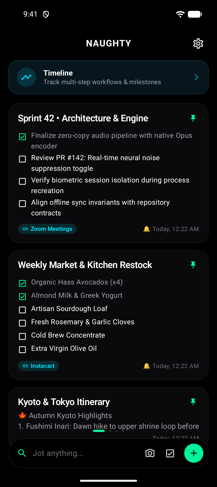
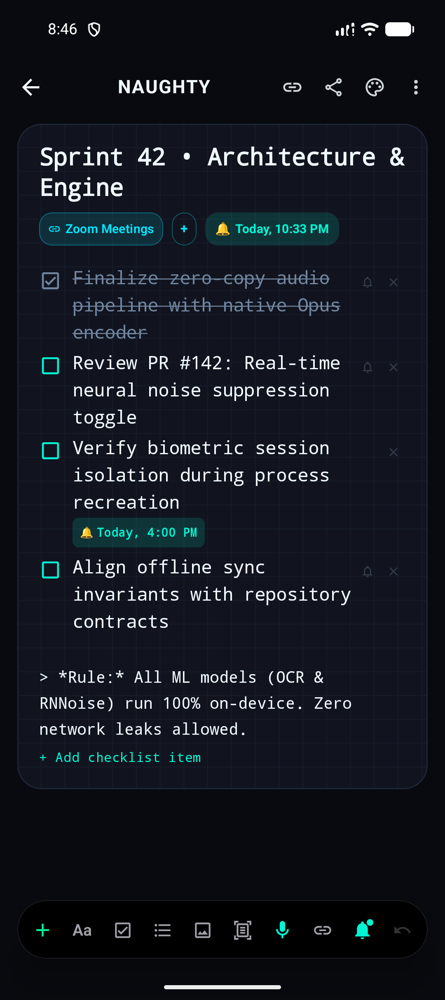
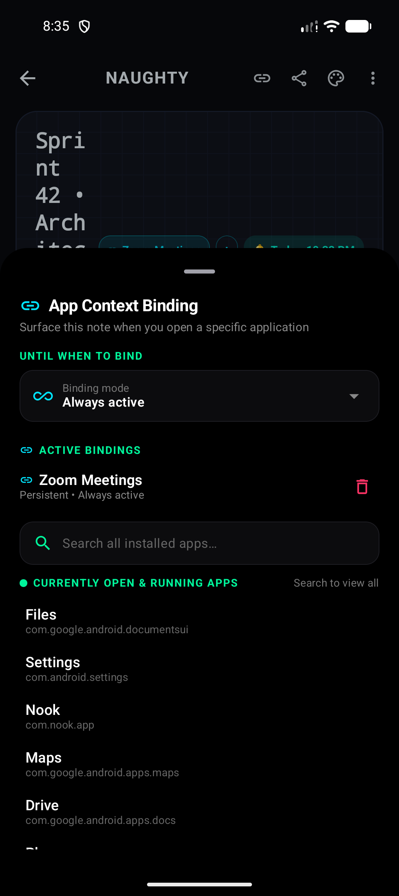
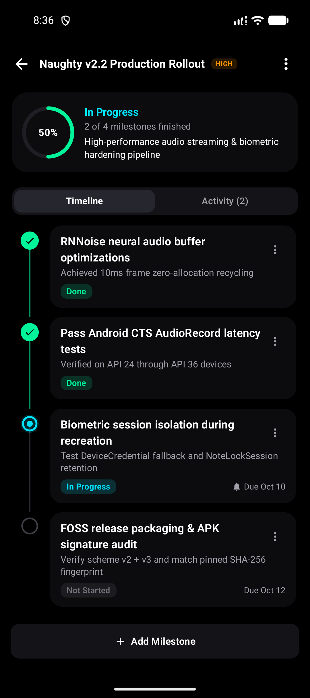
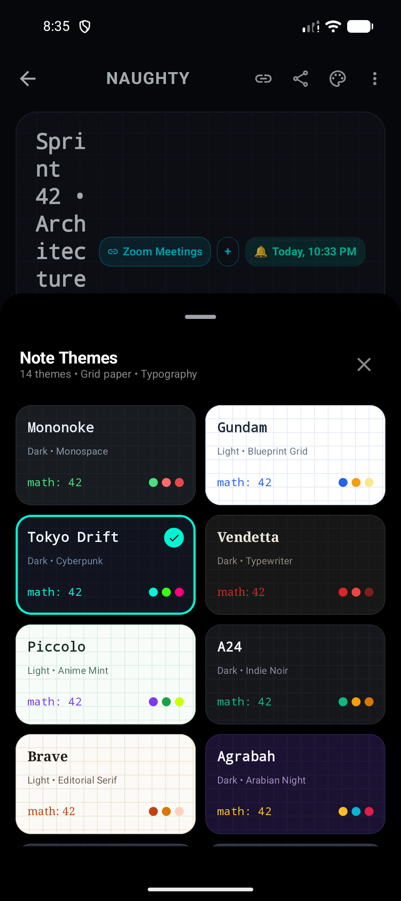

<div align="center">

# 📓 NAUGHTY

### *The Context-Aware, Offline-First Markdown Workspace & Timeline Engine for Android.*

[](https://github.com/pritesh-ranjan/Naughty/actions)
[](https://github.com/pritesh-ranjan/Naughty/releases/latest)
[](https://github.com/pritesh-ranjan/Naughty/releases)
[-34D399?style=flat-square&logo=android&logoColor=white)](app/build.gradle.kts)
[-059669?style=flat-square)](PRIVACY.md)
[](SECURITY.md)
[](LICENSE)

<br/>

> **Naughty connects your notes to your actions.**  
> Built strictly offline-first, Naughty surfaces relevant notes, checklists, and references as non-intrusive heads-up cards the moment you open designated applications—eliminating app-switching and search friction. Every note is saved as a physical Markdown (`.md`) file on device storage for absolute privacy and complete data ownership.

<br/>

<p align="center">
  
  
  
  
  
</p>

<br/>

[Core Capabilities](#-core-capabilities) •
[Technology Stack](#-technology-stack) •
[Themes & Canvas](#-handcrafted-themes) •
[Privacy & Security](#-privacy--security) •
[Download & Build](#-download--build) •
[License](#-license)

---

</div>

<br/>

## ⚡ Core Capabilities

### 🧠 Context-Aware App Binding
* **Autonomous Surfacing**: Link any note or checklist to specific third-party applications (e.g., view shopping lists inside delivery apps, or meeting agendas inside Zoom).
* **Flexible Trigger Rules**: Set bindings to surface **every time**, **once** (auto-dismissing after use), or until a **custom expiry date**.
* **Zero Disruption**: Displays as a lightweight heads-up card that automatically recedes when switching away from the bound application.

### 🗺️ Multi-Step Timeline Engine
* **High-Stakes Workflow Tracking**: Manage complex multi-stage efforts (visa applications, home purchases, product launches) via ordered milestones.
* **Deterministic Progress**: Computes completion mathematically (`done / (total - cancelled)`), accurately excluding cancelled milestones.
* **Audit Trail**: Immutable-style activity log captures status transitions, updates, and timestamped progress notes.
* **Milestone Alarms**: Schedule exact notifications tied directly to milestone deadlines.

### 📝 Hybrid Markdown Editor
* **Dual Editing Surface**: Fluidly switch between tactile block editing (interactive checkboxes, headings, text) and raw full-text Markdown.
* **Smart Indentation**: Auto-continuation of checklists and bullet points; pressing Enter on an empty checklist item exits cleanly to standard text.
* **Snapshot Undo / Redo**: Instant, in-memory state preservation supporting up to 30 history states.
* **Inline Reminders**: Embed date and time reminders natively inside Markdown text (`[🔔 Label](reminder:<timestamp>)`).
* **Visual Attachments & OCR**: Attach images directly and transcribe printed or handwritten text on-device using integrated OCR.

### 🎙️ Neural Voice Notes & Direct Opus Streaming
* **Real-Time Neural Denoising**: On-device AI suppression (Audx RNNoise) eliminates background noise, wind, and hum during capture.
* **Mid-Recording Denoise Toggle**: Switch between neural noise suppression and raw microphone audio on the fly without stopping the stream.
* **Zero WAV Overhead**: Raw 48 kHz PCM frames encode directly into an Opus/Ogg stream via native `MediaCodec`, saving storage and eliminating intermediate WAV files.
* **Interactive Waveform Player**: WhatsApp-style scrubber with tap-and-drag seeking, duration indicators, and 1x / 1.5x / 2x speed stepping.
* **Offline Dictation**: On-device speech recognition transcribes audio directly into notes without external network calls.

### 🔒 Hardware-Backed Biometric Security
* **Biometric Authentication**: Secure confidential notes using fingerprint, facial recognition, or device PIN/pattern fallback via `BiometricPrompt`.
* **Zero Preview Leakage**: Locked notes obscure body text across dashboard cards, search results, and notifications until explicitly authenticated.
* **Session Isolation**: Authentication remains valid only during active app lifecycle and resets upon app dismissal.

### 📥 Universal Ingestion & OS Integration
* **System Share Ingestion**: Create structured notes directly from text, links, single/batch images, or audio shared from any Android app.
* **System Context Menu**: Highlight text in any application and select "Add to Naughty" to capture thoughts immediately.
* **Launcher Shortcuts**: Long-press app launcher icon for quick actions to create a new note or open timeline trackers.
* **Reboot-Resilient Exact Alarms**: Exact alarms schedule through Android's `AlarmManager` with `BOOT_COMPLETED` rescheduling.

---

## 🛠️ Technology Stack

Naughty is engineered with modern Android architecture guidelines, leveraging an offline-first dual-storage pattern and hardware-accelerated processing:

| Layer | Architecture & Libraries | Description |
| :--- | :--- | :--- |
| **Language & Toolchain** | Kotlin 2.3.20 • JVM Target 17 • AGP 9.0.1 | 100% Kotlin codebase built with modern Gradle toolchains |
| **UI Framework** | Jetpack Compose • Material 3 • Navigation 3 | Declarative UI, edge-to-edge rendering, and adaptive layouts |
| **Architecture** | Unidirectional Data Flow (UDF) • Coroutines • StateFlow | Reactive state management with lightweight manual dependency injection |
| **Storage Engine** | Hybrid Dual-Storage: Room (SQLite) + Physical Markdown | Room indexes metadata and queries; ground truth lives as UTF-8 `.md` files on disk |
| **On-Device AI & ML** | Audx RNNoise • Google ML Kit • Android SpeechRecognizer | Neural audio denoising, Latin text OCR, and speech dictation executed 100% locally |
| **Audio Processing** | AudioRecord (48 kHz PCM) • MediaCodec • MediaMuxer | Real-time audio capture, low-latency streaming, and native Opus compression |
| **Security & Privacy** | AndroidX Biometric • Hardware Keystore / TEE | Biometric authentication backed by Android StrongBox / TEE hardware credentials |
| **Platform Target** | Android 7.0 (API 24) to Android 16 (API 36) | Target SDK 36 with backward compatibility down to Android 7.0 |

---

## 🎨 Handcrafted Themes

Customize your workspace with 14 curated color palettes paired with procedural paper textures rendered directly on Compose Canvas:

| Theme | Tone | Palette Vibe |
| :--- | :--- | :--- |
| **Mononoke** | Dark | Emerald Monospace & Deep Charcoal |
| **Gundam** | Light | Technical Blueprint Grid & Royal Cobalt |
| **Tokyo Drift** | Dark | Cyberpunk Neon Cyan & Electric Magenta |
| **Vendetta** | Dark | Typewriter Noir & Crimson Accent |
| **Piccolo** | Light | Anime Mint Paper & Royal Violet |
| **A24** | Dark | Indie Cinema Slate & Warm Amber |
| **Brave** | Light | Editorial Serif & Burnt Terracotta |
| **Agrabah** | Dark | Arabian Night Violet & Desert Gold |
| **Dracula** | Dark | Classic Dracula Slate, Pink & Mint |
| **Nord** | Dark | Arctic Frost Steel & Glacier Cyan |
| **Gruvbox** | Dark | Retro Warm Groove & Ochre Earth |
| **Solarized** | Light | Terminal Parchment & Solar Cyan |
| **Dot Matrix** | Dark | 80s CRT Phosphor Green Glow |
| **Flexoki** | Light | Inky Warm Paper & Forest Pine |

*Includes Light, Dark, and System Auto mode support with Canvas-rendered Blueprint Grid, Dot Grid, Ruled Lines, and Clean Canvas paper textures.*

---

## 🛡️ Privacy & Security

Naughty operates under strict privacy invariants:

* **100% Offline by Design**: `android.permission.INTERNET` is explicitly stripped from the application manifest. Naughty physically cannot transmit data across the internet.
* **Zero Telemetry**: No third-party trackers, analytics, ad networks, or remote crash reporting SDKs.
* **Local-Only Computation**: Machine learning models (OCR, neural noise suppression, voice recognition) execute entirely on-device without remote API calls.
* **Cloud Isolation**: Automatic cloud backups are explicitly disabled (`allowBackup="false"`) to protect confidential notes from unencrypted third-party drive syncs.
* **Open File Ground Truth**: Every note is stored as a plain Markdown (`.md`) file on device storage, fully accessible and compatible with tools like Obsidian, Logseq, and VS Code.

*For complete policies, see [Privacy Policy](PRIVACY.md) and [Security Policy](SECURITY.md).*

---

## 📦 Download & Build

### Install Release APK
Download the latest signed release APK from [**GitHub Releases**](https://github.com/pritesh-ranjan/Naughty/releases/latest):
1. Download the release `.apk` file.
2. Tap the file on your device to install (enable "Install Unknown Apps" if prompted).

### Install via ADB
```bash
adb install -r Naughty-release.apk
```

### Build from Source
Ensure Android Studio and JDK 17+ are installed:
```bash
# Clone the repository
git clone https://github.com/pritesh-ranjan/Naughty.git
cd Naughty

# Export Java Home
export JAVA_HOME="/Applications/Android Studio.app/Contents/jbr/Contents/Home"

# Run unit tests
./gradlew testDebugUnitTest

# Assemble Release APK
./gradlew assembleRelease
# Or use the automated release build script:
./build_release.sh
```

---

## 🤝 Contributing

Contributions are welcomed. To propose changes, report issues, or contribute new themes and features:
1. Fork the repository.
2. Create your feature branch (`git checkout -b feature/NewFeature`).
3. Ensure unit tests pass (`./gradlew testDebugUnitTest`).
4. Commit your changes (`git commit -m 'feat: Add NewFeature'`).
5. Push to the branch (`git push origin feature/NewFeature`).
6. Open a Pull Request.

---

## 📄 License

Distributed under the **MIT License**. See [`LICENSE`](LICENSE) for details.

<br/>

<div align="center">

Crafted with care for thinkers, builders, and privacy purists.  
**Naughty** — *Notes that know when to show up.*

</div>
